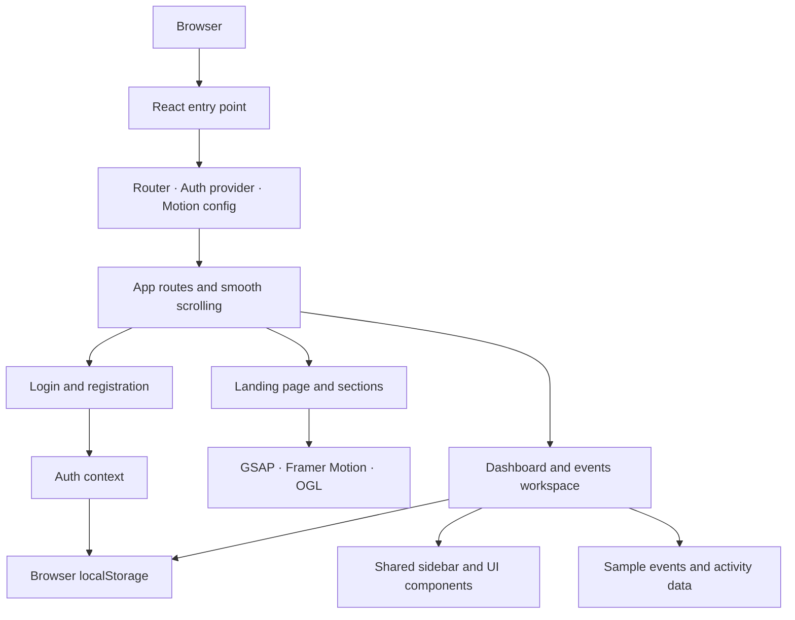
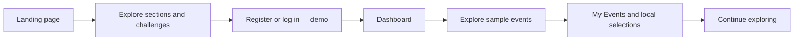

# CampusCode

**Build ideas. Find your people. Take the next step.**

[](https://react.dev/) [](https://vite.dev/) [](#demo-boundaries)

[Live website](https://campus-code-art.vercel.app/) · [Repository](https://github.com/dxtrovert/CampusCodeArt) · [Getting started](#getting-started)

CampusCode is a frontend prototype for a student innovation and hackathon platform. It brings the journey from discovering a problem to finding collaborators, building a project, and sharing the result into one visual experience. Its editorial landing page treats that journey as a sequence of interactive chapters; the workspace explores how a student might navigate events and personal activity.

> **Current scope:** CampusCode is a client-side demonstration. Authentication, event registration, and profile state are local browser features, not production services. The event catalogue and dashboard activity are sample data.

## Contents

- [The experience](#the-experience)
- [Animation and interaction engineering](#animation-and-interaction-engineering)
- [Architecture and data flow](#architecture-and-data-flow)
- [Technology](#technology)
- [Design system](#design-system)
- [Project structure](#project-structure)
- [Getting started](#getting-started)
- [User journey](#user-journey)
- [Screenshots and demo](#screenshots-and-demo)
- [Engineering decisions](#engineering-decisions)
- [Demo boundaries](#demo-boundaries)
- [Future work](#future-work)
- [Project information](#project-information)

## The experience

### Landing page

Seven independently composed sections tell the CampusCode story in an alternating light and dark sequence:

| Chapter | Experience |
| --- | --- |
| Hero | **Build. Compete. Ship.** Oversized typography, a WebGL image carousel, foreground portrait, three editorial panels and a statistics strip. |
| About | An introduction to the platform and flip cards for Ideate, Collaborate, Compete and Ship. |
| Build Together | A community message and a locally bundled video with a custom play/pause control. |
| How It Works | Four illustrated process cards with flip interactions and links to existing destinations. |
| Enter the Arena | Three image-led challenge cards with categories, sample statuses and registration links. |
| Find Your People | A community illustration and a message about working across disciplines. |
| Your Next Project Starts Here | A final call to action with interactive TechText lettering. |

The shared sticky header changes treatment as dark sections expand. Rounded panels, a restrained grid behind sections, a custom cursor, color accents and hover feedback connect the visual language across the page. Responsive CSS adapts navigation and layouts to smaller screens.

### Account and workspace

- **Login and registration:** enter demo details to populate a locally stored profile and open the dashboard. Login accepts a username and a nonempty password without verifying credentials. Registration does not verify passwords or email. Passwords are not stored or authenticated. Google and GitHub controls are disabled placeholders.
- **Dashboard:** displays the stored name, a featured ReBuild ’26 card, statistics calculated from local sample-event selections, related-event links and an expandable Recharts activity chart. The chart uses static sample data.
- **Explore and My Events:** `/explore` and `/events` currently render the same sample event interface. Search, event details and the All Events / Registered filters work with three local event records. “Add to My Events” toggles a selection on the current device; it does **not** register a user for a real event. Hosting and Team Events have no data in this demo.
- **Workspace navigation:** Dashboard, Explore, My Events, My Projects, Team, Saved, Notifications, Settings and Profile share a sidebar. Projects, Team and Settings have unavailable states; Saved and Notifications have empty states. Profile displays local information and supports choosing or removing a local image of up to 1 MB. Signing out clears the local profile.

The landing-page counters and sample event statuses are presentation data, not verified platform metrics or live event information.

## Animation and interaction engineering

Motion is used to guide attention from one chapter to the next, reveal content in sequence and give the interface a sense of continuity. Different tools have distinct responsibilities:

| Interaction | Implementation | Purpose |
| --- | --- | --- |
| Smooth scrolling | Lenis in `useSmoothScroll.js`, driven by GSAP's ticker | Smooths wheel scrolling and calls `ScrollTrigger.update()` when Lenis scrolls. |
| Section scenes | GSAP timelines and ScrollTrigger in `useScrollTrigger.js` | Pins post-hero sections on qualifying desktop viewports, animates their clipped edges, staggers content reveals and retracts the panel before release. |
| Header theme | `SiteHeader.jsx`, section theme attributes and CSS custom properties | Reads the active section and expansion progress to blend the header treatment. |
| Hero carousel | React Bits `FlexCarousel.jsx`, OGL/WebGL and a separate hero ScrollTrigger | Displays the image rail behind a foreground portrait; hero scroll progress selects carousel steps. |
| Entrances | Framer Motion `Reveal` and hero motion components | Adds viewport-based reveals and staggered headline/portrait entrances. |
| Interactive cards | React Bits `FlipCard.jsx` with `motion/react` | Flips the About and Process cards to reveal additional copy. |
| Interactive lettering | React Bits `TechText.jsx` | Draws the final CTA text on canvas with pointer-driven letter effects; “PROJECT” starts outlined. |
| Cursor and hover | CSS and the supplied cursor asset | Adds visual feedback to links, controls and card surfaces. |

<details>
<summary><strong>How the scroll scenes are coordinated</strong></summary>

`useSmoothScroll` creates one Lenis instance for the mounted app. A GSAP ticker callback passes elapsed time to `lenis.raf`, and Lenis scroll events update ScrollTrigger. Cleanup removes the ticker callback and listener and destroys Lenis.

For screens at least **901px wide and 700px high**, when reduced motion is not requested, `useScrollTrigger` creates a timeline for each landing section after the hero. Each uses the measured header offset, pin spacing, scrubbed progress and refresh invalidation. The timeline animates the section's `clip-path` and expansion value, then restores the inset. The same progress can be traversed backward; it also feeds the theme-aware header and related CSS. `gsap.matchMedia` reverts the scene setup on cleanup. These are pinned, clipped panels in normal document flow—not CSS scroll snapping or a separately stacked page system.

The hero has its own GSAP context and pin. Its ScrollTrigger maps progress to discrete carousel targets and dispatches carousel keyboard steps. Pointer movement also drives a separate GSAP parallax effect on the foreground portrait. The hero context, pointer listeners and resize observer are cleaned up on unmount. Reverse movement is supported through the scroll-progress mapping, but the carousel remains step-based rather than a continuous scrubbed video; boundary behavior deserves further device testing.

Framer Motion handles `Reveal` entrances and hero staggered elements, while the installed `motion` package powers the flip card springs. CSS supplies hover and focus treatments. The project does not use a shared-layout page transition system.

</details>

<details>
<summary><strong>Responsive motion, cleanup and performance</strong></summary>

- The post-hero pinned timelines are skipped for smaller or shorter viewports and for reduced-motion preference; sections remain in document flow.
- Lenis and hero pin/parallax setup are skipped for reduced motion. `MotionConfigProvider`, component-level reduced-motion checks and CSS rules also reduce motion in supported components.
- The hero observes its size and refreshes ScrollTrigger; sections use `invalidateOnRefresh`. GSAP contexts, media-query setups, observers, listeners and ticker callbacks have cleanup paths.
- Routes are lazy-loaded with React `Suspense`; image/video assets are bundled or served locally. Some images use lazy loading.
- These measures do not replace testing on real devices. WebGL support, large image/video transfers, reduced-motion behavior and long pinned scenes should be checked across browsers.

</details>

## Architecture and data flow

`src/main.jsx` mounts React under `BrowserRouter`, `AuthProvider` and a Framer Motion configuration. `App.jsx` creates the routes, loads pages lazily, manages the shared header and initializes smooth scrolling. Landing sections and workspace pages compose reusable components, while local data files and context supply demo state.



The demo account flow is: **form input → `signIn` in `AuthContext` → `campuscode-user` in localStorage → dashboard greeting**. Registration passes the entered name and email into that profile; login uses the entered username as the displayed name. No password or identity is verified. Event selections use a separate `campuscode-demo-events` key. These keys are browser-local, not synchronized accounts.

| Route | Current purpose |
| --- | --- |
| `/` | Landing page |
| `/login`, `/register` | Demo account forms |
| `/dashboard` | Personalized overview |
| `/events`, `/explore` | Sample event list, search and local selection |
| `/projects`, `/team`, `/saved`, `/notifications`, `/settings`, `/profile` | Workspace pages; most are empty or unavailable states, with a local profile view |

The app uses browser-history routing. A production host must serve `index.html` for application routes on direct visits and refreshes.

## Technology

Versions below are the ranges declared in `package.json`; `package-lock.json` records the resolved installation.

| Layer | Technology | Role |
| --- | --- | --- |
| Frontend | React `^18.3.1`, JavaScript | Components, state and rendering |
| Build | Vite `^6.0.7`, React plugin `^4.3.4` | Development server, bundling and lazy route chunks |
| Styling | Tailwind CSS `^3.4.17`, custom CSS, PostCSS, Autoprefixer | Utilities, responsive styles and design tokens |
| Animation | GSAP `^3.14.2` / ScrollTrigger, Lenis `^1.3.15`, Framer Motion `^11.18.2`, Motion `^12.43.0` | Scroll scenes, entrances and interactive card motion |
| Graphics | OGL `^1.0.11` | WebGL rendering for the hero carousel |
| Routing | React Router DOM `^7.18.5` | Browser routes and navigation |
| Icons | Lucide React `^0.468.0` | Interface icons |
| Visualization | Recharts `^2.15.0` | Sample dashboard activity chart |
| Persistence | Browser `localStorage` | Demo profile and event selections |

## Design system

CampusCode combines an ivory canvas, strong black type, outlined rounded panels and alternating light/dark chapters. Lime highlights calls to action; purple appears in artwork, cards and interactions. The same color vocabulary and rounded borders carry through to the dashboard.

| Token | Value |
| --- | --- |
| Background | `#F7F7F4` |
| White | `#FFFFFF` |
| Purple | `#7665FF` |
| Lime | `#A8E62E` |
| Secondary lime | `#82B91A` |
| Black | `#111111` |
| Border | `#DEDED8` |

Inter is the primary interface family, Montserrat Black is used for the desktop hero headline, and DM Mono provides labels and metadata. Font requests and fallbacks are defined in the project; CSS variables live in `src/styles/index.css`, with corresponding Tailwind configuration in `tailwind.config.js`. See [DESIGN_SYSTEM.md](DESIGN_SYSTEM.md) for the design record.

## Project structure

```text
CampusCodeArt/
├── Assets/                    # Original supplied artwork
├── public/images/             # Public cursor and hero assets
├── ui/                        # Design references, not app screenshots
├── src/
│   ├── assets/                # Imported illustrations, logo and video
│   ├── components/
│   │   ├── animations/        # Motion configuration
│   │   ├── common/            # Buttons, labels, reveal and shared UI
│   │   ├── dashboard/         # Workspace shell
│   │   ├── layout/            # Site header and footer
│   │   ├── sections/          # Seven landing sections
│   │   ├── FlexCarousel.jsx   # OGL carousel
│   │   ├── FlipCard.jsx       # Interactive flip cards
│   │   └── TechText.jsx       # Canvas text interaction
│   ├── context/               # Demo auth provider
│   ├── data/                  # Landing copy, sample events and activity
│   ├── hooks/                 # Storage, Lenis and ScrollTrigger hooks
│   ├── pages/                 # Landing, auth and workspace pages
│   ├── services/              # Local profile helper functions
│   ├── styles/                # Global CSS and responsive rules
│   ├── utils/                 # Formatting helpers
│   ├── App.jsx                # Routes and shared app shell
│   └── main.jsx               # Entry point and providers
├── CAMPUSCODE_PROGRESS.md     # Development history
├── DESIGN_SYSTEM.md
├── package.json
└── vite.config.js
```

`ui/` contains reference mockups rather than rendered pages. It is listed in `.gitignore`; files already tracked by Git can still be present in the repository. Assets under `src/assets/` are imported through Vite; `public/images/` contains files referenced by public paths. `Assets/` retains supplied originals.

## Getting started

### Prerequisites

- Node.js **20 or newer** and npm. React Router's installed package requires Node 20 or later; Node 20 or 22 LTS is a practical choice.
- A modern browser with WebGL support for the hero carousel.

### Install and run

```bash
git clone https://github.com/dxtrovert/CampusCodeArt.git
cd CampusCodeArt
npm ci
npm run dev
```

Vite normally prints a local address such as `http://localhost:5173/`; it may choose another port if that one is in use. Use the address printed in the terminal.

### Production build

```bash
npm run build
npm run preview
```

The build is emitted to `dist/`. Configure the deployment host to fall back to `index.html` for client-side routes. There are currently no test or lint scripts in `package.json`.

## User journey



The landing header also links directly to the dashboard. Routes are not protected by a backend authentication system; a direct workspace visit can display the fallback builder state.

## Screenshots and demo

No verified screenshots of the current running application are included in this README. The images in `ui/` are design references, and individual illustrations are not substitutes for screenshots.

**Capture and add:**

- [ ] Landing hero and carousel in the running application.
- [ ] Representative light and dark section transitions, ideally as a short GIF or video.
- [ ] Dashboard overview and the events / My Events views.
- [ ] Login and registration pages.
- [ ] A mobile view showing navigation and responsive cards.

Once captured, commit the files in a suitable tracked documentation folder and use relative paths here. An optional short demo should show both scroll directions, the section transitions, card flips and the workspace journey.

## Engineering decisions

- **Component boundaries:** landing chapters, forms and workspace pages are separated from shared navigation, buttons and layout components, keeping visual sections independently maintainable.
- **Different motion tools for different jobs:** GSAP coordinates scroll-linked timing; Lenis handles smooth scrolling; Framer Motion supports declarative entrances; OGL renders the hero carousel; React Bits components provide the flip-card and text interactions.
- **Local state as a prototype boundary:** context and `useLocalStorage` make the demo navigable without implying a database or identity provider. Event and profile data are deliberately local to a browser.
- **Shared tokens and assets:** a small palette of CSS variables and reusable brand elements keeps the light landing sections, dark sections and workspace visually related. Source assets are imported or placed under `public/` according to how they are served.
- **Cleanup and motion preferences:** listeners, triggers and animation loops have explicit lifecycle handling; reduced-motion and responsive branches provide alternatives to the desktop scroll scenes.

## Demo boundaries

| Area | Available today | Boundary |
| --- | --- | --- |
| Account | Local demo profile and dashboard greeting | No credential verification, database, real account security or OAuth. |
| Events | Three sample cards, search, local selections and filters | No live registration or event service. Hosting and team filters have no data. |
| Dashboard | Derived local selection counts and sample activity chart | Metrics are not backed by a server; certificates are not issued. |
| Workspace | Shared sidebar, profile image and placeholder pages | Projects, team, saved items, notifications and settings are not complete product features. |
| Landing | Seven chapters, scroll scenes, video and interactive components | Production browser/device coverage and accessibility should be expanded. |

## Future work

- Connect secure authentication, a backend and a database; replace demo credentials and local-only state.
- Add real event discovery, registration, hosting, teams and project submissions.
- Build out profile settings, saved items and notifications.
- Expand keyboard, screen-reader and reduced-motion testing; test scroll and carousel behavior across devices.
- Add automated tests and evaluate asset sizes, WebGL fallback and runtime performance.

## Project information

**CampusCode** · [GitHub repository](https://github.com/dxtrovert/CampusCodeArt) · [Live website](https://campus-code-art.vercel.app/)

Built with React and Vite, combining frontend engineering, motion design and a visual identity centered on student builders. See [CAMPUSCODE_PROGRESS.md](CAMPUSCODE_PROGRESS.md) for the development history and [DESIGN_SYSTEM.md](DESIGN_SYSTEM.md) for established design decisions.
